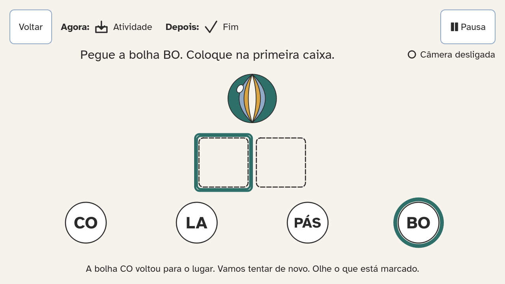
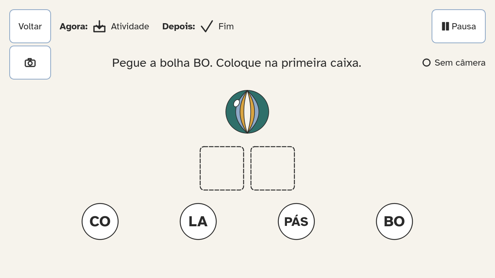
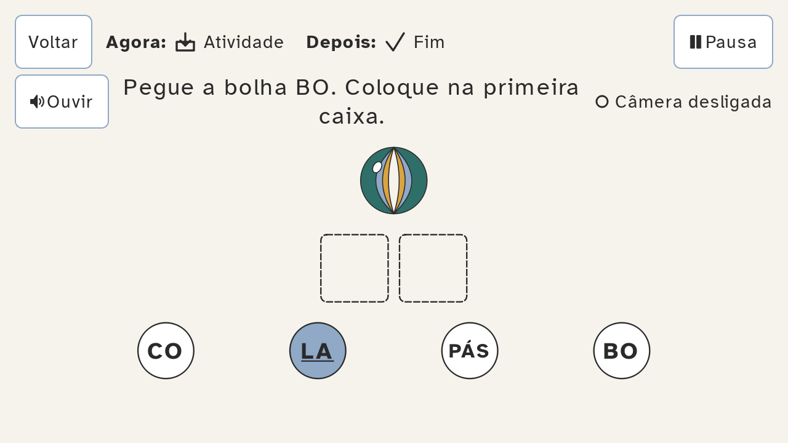
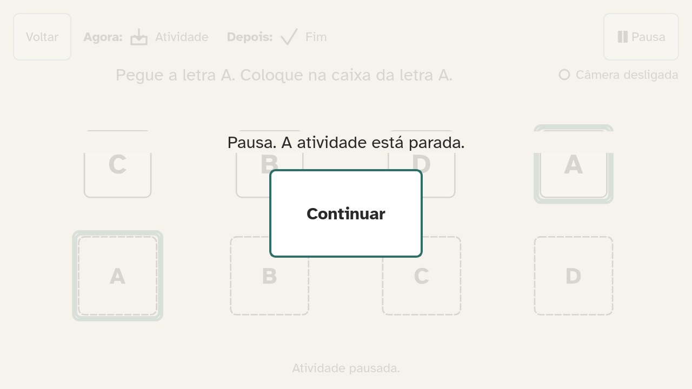
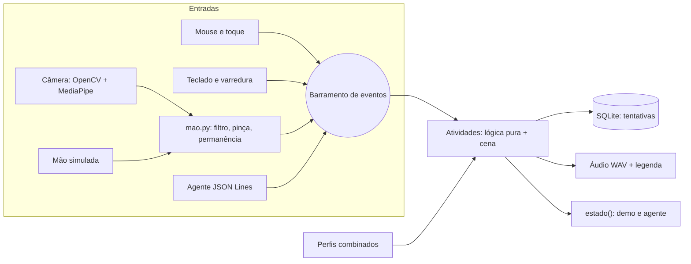

# Atlas

[](https://github.com/edpl22/hackthonAstros/actions/workflows/ci.yml)

Na mesma sala, uma criança com TEA, outra com dislexia e outra com baixa visão precisam aprender o mesmo conteúdo, e o professor não tem tempo de refazer cada atividade.
O Atlas é um software desktop de português e matemática para Educação Infantil ao 4º ano, em que a criança aprende com o corpo: mão na câmera, toque, mouse ou teclado.
**A mesma atividade se ajusta ao perfil de cada aluno** (TEA, TDAH, dislexia, baixa visão, daltonismo, dificuldade motora, cegueira parcial). O professor só marca os perfis.
É a resposta ao Desafio 01 da Teachy: *"Como podemos ajudar professores, escolas e família a fazerem com que todos os alunos aprendam o mesmo conteúdo, junto com a turma?"*
Cada jogada vira um registro com o tipo de erro e uma sugestão para o professor. Nada sai do computador.



## Como executar e avaliar sem tela

O Atlas é um aplicativo de janelas (Qt). Ele não abre no navegador. Para avaliar sem monitor e sem webcam, use os modos de linha de comando abaixo: eles rodam o app real em modo `offscreen` e salvam texto, JSON e imagens PNG. Todos os comandos foram executados a partir de um clone limpo por `scripts/verificar_readme.sh`.

Requisito: Docker (ou Python 3.11). Tempo estimado: 5 a 10 min.

### Caminho A: Docker (recomendado)

```bash
git clone https://github.com/edpl22/hackthonAstros && cd hackthonAstros
docker compose build
docker compose run --rm verificar
docker compose run --rm demo
docker compose run --rm teste
echo '{"acao":"estado"}' | docker compose run --rm -T agente
```

Sem build, com a imagem pronta: `docker run --rm ghcr.io/edpl22/atlas:latest verificar` (os outros comandos também funcionam assim, por exemplo `docker run --rm -v "$PWD/saida:/saida" ghcr.io/edpl22/atlas:latest demo todas --saida /saida`).

| Comando | O que faz | Saída esperada |
| --- | --- | --- |
| `docker compose build` | Monta a imagem (Python 3.11, Qt, OpenCV, MediaPipe) | `Image atlas:local Built` |
| `docker compose run --rm verificar` | Confere o ambiente, uma linha por item | Última linha: `RESULTADO: pronto` |
| `docker compose run --rm demo` | Joga as atividades por roteiro e salva evidências em `./saida/` | `demo todas: 53 capturas; ...` e `relatorio: /saida/relatorio.md` |
| `docker compose run --rm teste` | Roda a suíte de testes (pytest) | Última linha com `passed` e sem `failed` |
| `echo ... \| docker compose run --rm -T agente` | Abre o Ímã das Sílabas em BOLA e responde em JSON | 1ª linha `{"pronto": true, ...}`; 2ª linha com o `estado` |

### Caminho B: Python, sem Docker

```bash
python3.11 -m venv .venv && . .venv/bin/activate
pip install -r requirements.txt && pip install .
export QT_QPA_PLATFORM=offscreen ATLAS_AUDIO=nulo
atlas verificar && atlas demo todas --saida ./saida
```

No Windows: `py -3.11 -m venv .venv` e `.venv\Scripts\activate`. No Linux sem interface gráfica, o Qt precisa de `libegl1 libgl1 libxkbcommon0 libdbus-1-3 libfontconfig1` (e a câmera, de `libgles2`). A câmera é opcional (`pip install -r requirements-camera.txt`); sem ela, `atlas verificar` mostra `--  camera: ...` e o app usa mouse, toque e teclado.

### Caminho C: só ler

- [`docs/AVALIACAO.md`](docs/AVALIACAO.md): cada afirmação sobre o produto, onde está no código e como verificar.
- [`docs/saida-exemplo/`](docs/saida-exemplo/): saídas reais já geradas pelos comandos acima (`scripts/gerar_saida_exemplo.sh`).

### O que olhar em `saida/`

| Arquivo | O que mostra |
| --- | --- |
| `relatorio.md` | Tabela de cada passo: evento, frase narrada, captura, tipo de erro e pista |
| `captura-NN-<passo>.png` | A tela real em cada passo, nos 3 momentos de cada atividade |
| `tentativas.json` | O registro de cada resposta: item, resposta, se acertou, tipo de erro, pistas, se precisou do modelo, tempo, entrada e perfis |
| `eventos.jsonl` | Um evento por linha, com a frase narrada e a entrada usada |
| `audio.log` | Cada áudio que tocaria (no Docker não há som). Só o português tem voz: a letra ou a sílaba pega e a palavra pronta |

Os roteiros têm **erros propositais**. Eles mostram a resposta neutra ("Vamos tentar de novo"), as pistas graduais (1ª repete a instrução, 2ª realça, 3ª mostra o modelo) e a classificação do erro: `ordem_trocada`, `silaba_de_outra_palavra`, `par_surdo_sonoro`, `tonica_errada`, `letra_trocada`, `um_a_mais_ou_menos`, `operacao_trocada`, `digitos_invertidos`, `comparacao_errada`, `somou_denominadores`, `contou_fatias_errado`, `confundiu_numerador_denominador`.

### Variações

```bash
atlas demo silabas --perfil tea,dislexia --entrada teclado --saida ./saida-tea
atlas perfis --combinar tea,dislexia
```

- `demo`: roteiros `navegacao`, `treino`, `silabas`, `quantidades`, `pizza`, `dourado`, `tabuada`, `painel` ou `todas`.
- `--perfil`: `padrao`, `tea`, `tdah`, `dislexia`, `baixa_visao`, `daltonismo`, `motor`, `cegueira` (combináveis com vírgula; vence a opção mais acessível).
- `--entrada`: `mouse`, `teclado`, `varredura` ou `mao-simulada`. A mão simulada gera os 21 pontos de uma mão que aponta, faz pinça e solta, e eles passam pelo mesmo código da câmera (`app/entrada/mao.py`).
- No Docker, os mesmos argumentos vão depois do serviço: `docker compose run --rm demo demo silabas --perfil tea --saida /saida`.

A câmera real não é testável sem webcam; o caminho dela é coberto por `--entrada mao-simulada` e pelos testes de `mao.py`.

### Protocolo do agente (`atlas agente <atividade>`)

JSON Lines: um pedido JSON por linha no stdin, uma resposta JSON por linha no stdout. Atividades: `silabas` (começa em BOLA; `--palavra janela` troca), `quantidades` (Mesa: `{"acao":"escolher","id":"cartao-7"}`), `pizza` (`fatia-a-0` escolhe uma fatia; `cartao-3-4` escolhe 3/4), `dourado` (`pegar` a peça de cima de uma pilha, como `centena-8`, e `soltar` em `coluna-centena`; depois `escolher` `cartao-pronto`), `tabuada` (`escolher` com o id de um monstrinho acerta ele) e `treino`.

| Ação | Exemplo |
| --- | --- |
| estado | `{"acao": "estado"}` |
| pegar / soltar | `{"acao": "pegar", "id": "bolha-bo-3"}` / `{"acao": "soltar", "alvo": "caixa-1"}` |
| escolher | `{"acao": "escolher", "id": "bolha-bo-3"}` (nível 4: sílaba mais forte) |
| apontar | `{"acao": "apontar", "x": 640, "y": 280}` (coordenadas da cena, 1280 x 560) |
| proximo | `{"acao": "proximo"}`: "Começar", "Próximo" ou resposta ao desafio (`"sim": true`) |
| pausar / continuar | `{"acao": "pausar"}` |
| captura | `{"acao": "captura", "arquivo": "passo.png"}` |
| sair | `{"acao": "sair"}` |

Exemplo, montando BOLA com um erro no meio:

```bash
printf '%s\n' '{"acao":"proximo"}' \
  '{"acao":"pegar","id":"bolha-la-1"}' '{"acao":"soltar","alvo":"caixa-1"}' \
  '{"acao":"pegar","id":"bolha-bo-3"}' '{"acao":"soltar","alvo":"caixa-1"}' \
  '{"acao":"pegar","id":"bolha-la-1"}' '{"acao":"soltar","alvo":"caixa-2"}' \
  '{"acao":"sair"}' | docker compose run --rm -T agente
```

Resposta (resumida):

```json
{"ok": true, "anuncio": "A bolha LA voltou para o lugar. Vamos tentar de novo. Pegue a bolha BO. Coloque na primeira caixa.", "estado": {"pista_nivel": 1, "...": "..."}}
{"ok": true, "anuncio": "Bolha LA colocada na segunda caixa.", "estado": {"concluida": true, "momento": "fim", "...": "..."}}
```

Ids estáveis: `bolha-<sílaba>-<n>`, `caixa-<n>`, `peca-<letra>-<n>`, `objeto-<conjunto>-<n>`, `bandeja-a`, `bandeja-b`, `cartao-<valor>`, `fatia-<pizza>-<n>`, `cartao-<num>-<den>`. O `estado` traz a tela, o momento, o nível, a instrução, os itens e alvos com posição, a pista atual e se concluiu. Erros vêm como `{"ok": false, "erro": "item inexistente: bolha-xx", "dica": "ids disponiveis: ..."}`. A sessão completa está em [`docs/saida-exemplo/agente-respostas.jsonl`](docs/saida-exemplo/agente-respostas.jsonl).

### Problemas comuns

- **`docker compose` não existe:** em versões antigas o comando é `docker-compose` (com hífen).
- **Mac com Apple Silicon ou Linux ARM:** se o MediaPipe não tiver pacote para a arquitetura, o build continua sem câmera (`AVISO: ...`). Verificar, demo, testes e agente não dependem dela.
- **`saida/` com dono root no Linux:** o contêiner roda como root; use `sudo chown -R $USER saida`.
- **Build lento:** o primeiro `docker compose build` baixa cerca de 600 MB de pacotes Python. Os seguintes usam o cache.

## Para uma pessoa

- **Instalador:** baixe `Atlas-windows.zip` ou `Atlas-macos.zip` na [última Release](https://github.com/edpl22/hackthonAstros/releases/latest), descompacte e abra.
  - **Windows:** abra `Atlas\Atlas.exe`. Como o app não é assinado, o SmartScreen pode avisar: clique em "Mais informações" e depois em "Executar assim mesmo".
  - **macOS (Apple Silicon):** clique com o botão direito em `Atlas.app` e escolha "Abrir", ou rode `xattr -dr com.apple.quarantine Atlas.app` no Terminal. Em Macs Intel, use o Docker ou o Caminho B.
  - O executável também aceita os comandos sem tela: `Atlas.exe verificar --completo` confere até o detector da mão.
- **Pelo código** (Windows, macOS inclusive Intel, Linux): veja [Abrir a interface pelo código](#abrir-a-interface-pelo-código).
- **Sem webcam:** o Atlas usa mouse, toque e teclado sem nenhuma mensagem de erro; só aparece "Câmera desligada".
- **Com webcam:** o instalador já traz a câmera; pelo código, instale `requirements-camera.txt`. A câmera liga só dentro de uma atividade. Junte o polegar e o indicador (pinça) para pegar e abra para soltar.
- **Teclado:** Tab ou setas movem o foco; Enter ou Espaço pega e solta; Esc pausa.
- **Área do adulto:** segure o botão "Área do adulto" por 2 segundos. Lá ficam o cadastro (só apelido e um bicho, nunca o nome completo), os perfis, o volume, a opção de travar o nível, exportar JSON e apagar todos os dados.

### Abrir a interface pelo código

Requisito: Python 3.11 ou 3.12 (o MediaPipe não roda no 3.13). O Docker não abre a janela; ele serve para os modos sem tela.

```bash
git clone https://github.com/edpl22/hackthonAstros && cd hackthonAstros
python3.11 -m venv .venv && . .venv/bin/activate
pip install -r requirements.txt -r requirements-camera.txt
python -m app.main
```

- **Windows:** `py -3.11 -m venv .venv` e `.venv\Scripts\activate`; o resto é igual.
- **Sem webcam:** pode deixar de fora `-r requirements-camera.txt`.
- Rode de dentro da pasta clonada: o app procura `assets/` e `conteudo/` ali.
- Não defina `QT_QPA_PLATFORM=offscreen` (é só para o Caminho B, sem tela); se ela estiver no terminal, a janela não aparece.
- **Linux com área de trabalho:** se aparecer um erro do plugin "xcb", instale `libxcb-cursor0` (`sudo apt install libxcb-cursor0`).

## O que já existe

| Atividade | Estado |
| --- | --- |
| Ímã das Sílabas (português): 15 palavras, 4 níveis, sílaba tônica | Pronta |
| Treino de arrastar (alfabeto inteiro em blocos de 4 letras, maiúsculas e minúsculas) | Pronto |
| Teste da mão (câmera), no canto inferior esquerdo da tela inicial | Pronto |
| Mesa de Quantidades (matemática): montar, comparar, somar e subtrair até 20 | Pronta (sem o modo Par/ímpar) |
| Pizza de Frações (matemática): montar, somar, operar com 2 ou 3 pratos (soma e subtração), frações impróprias, barra de chocolate | Pronta |
| Jogo Dourado (matemática): montar o número com cubo, placas, barras e cubinhos no quadro valor de lugar, até 9.999 | Pronto |
| Tabuada Protetora (matemática): 1 minuto, monstrinhos com resultados, +1 no certo e -1 no errado; pelo mouse ou pela "arminha" da mão (coice para cima dispara) | Pronta; os monstrinhos são retângulos (placeholder) |
| Botão de câmera abaixo do Voltar em toda atividade: começa ligada e desliga a mão quando ela atrapalha | Pronto |
| Instaladores Windows e macOS e imagem Docker pronta (GHCR) | Publicados a cada versão (Releases) |
| Painel do professor: Domina, Em progresso, Precisa de apoio e recomendações (área do adulto) | Pronto; a turma de demonstração é fictícia e rotulada |

## Capturas

| Perfil padrão | Dislexia: sílabas alternadas e espaçamento | Pausa |
| --- | --- | --- |
|  |  |  |

## Arquitetura



As atividades só escutam o barramento: não sabem se a jogada veio da mão, do mouse, do teclado, do roteiro de demonstração ou do agente. Detalhes em [`docs/ARQUITETURA.md`](docs/ARQUITETURA.md).

## Privacidade

- O vídeo da câmera nunca sai do computador e nenhum quadro é salvo (`tests/test_privacidade.py` falha se o código usar `imwrite` ou módulos de rede).
- Não há nenhuma chamada de rede enquanto o app roda; só os scripts de preparo (`scripts/`) acessam a internet.
- Os alunos têm só apelido e avatar. Os dados ficam num SQLite local e podem ser exportados ou apagados na área do adulto.

## Créditos e licenças

Código sob licença MIT. Fonte Atkinson Hyperlegible (OFL), MediaPipe Hand Landmarker (Apache 2.0), OpenCV (Apache 2.0), Qt for Python (LGPL) e voz gerada com eSpeak NG. Lista completa em [`CREDITOS.md`](CREDITOS.md); decisões técnicas em [`docs/DECISOES.md`](docs/DECISOES.md).
