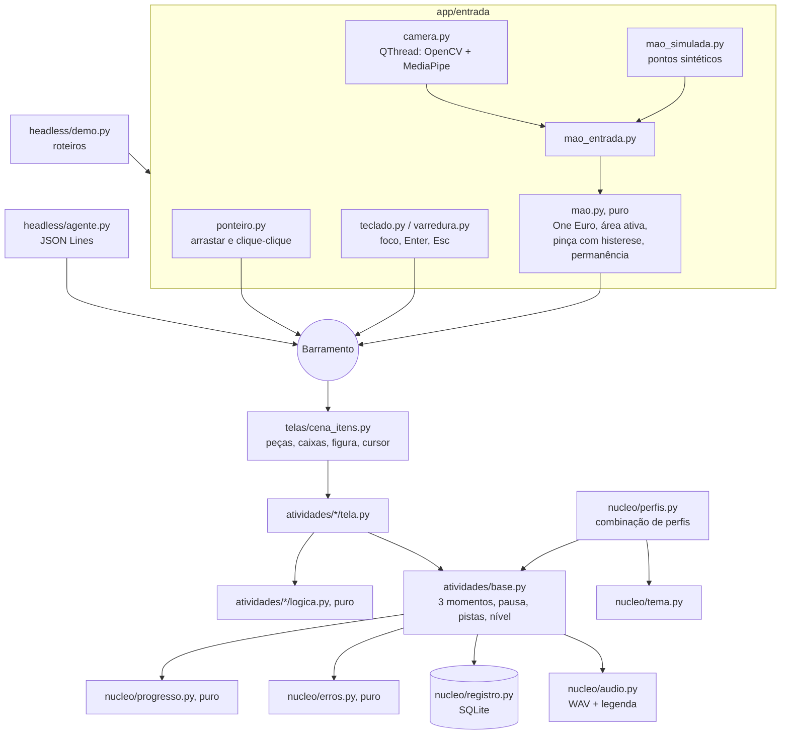

# Arquitetura do Atlas

## Ideia central

Toda entrada vira o mesmo punhado de eventos num **barramento** (`app/nucleo/eventos.py`): `apontar(x, y)`, `pegar()`, `soltar()`, `escolher(id)`, `pausar()`, `continuar()`. As atividades só escutam esse barramento. Por isso a mão na câmera, o mouse, o teclado, a varredura, o roteiro do `atlas demo` e o `atlas agente` exercitam exatamente o mesmo código da atividade.

Toda regra fica em **funções puras com testes**: classificar erros, pistas, nível, pinça, filtro, encaixe. Os widgets só desenham e repassam eventos.

## Pastas

| Pasta | Conteúdo |
| --- | --- |
| `app/nucleo/` | Barramento, perfis, tema, registro (SQLite), áudio, progresso (pistas e nível), erros, frases |
| `app/entrada/` | Mouse/toque, teclado, varredura, câmera, lógica pura da mão, mão simulada, cursor |
| `app/atividades/` | `base.py` (o que toda atividade cumpre) e uma pasta por atividade: `logica.py` (puro) e `tela.py` |
| `app/telas/` | Início, matérias, trilhas, área do adulto, cena genérica de pegar e soltar, ícones desenhados |
| `app/headless/` | `atlas verificar`, `atlas demo`, `atlas agente`, relatório |
| `conteudo/` | Frases, palavras, trilhas, recomendações, manifesto de áudio, roteiros da mão simulada |
| `assets/` | Fonte, modelo da mão, figuras SVG, WAV |

## Uma jogada, do começo ao fim

1. A criança fecha a pinça sobre a bolha BO. A `camera.py` (thread própria) manda os 21 pontos da mão.
2. `mao.py` filtra a ponta do indicador (One Euro), mapeia a área ativa para a cena e vê a pinça fechar (abaixo de 0,25; abre acima de 0,40).
3. `mao_entrada.py` emite `apontar(x, y)` e `pegar()` no barramento.
4. A cena acha a bolha mais próxima dentro da tolerância do perfil e avisa a atividade, que toca a sílaba "bó".
5. A criança leva a mão até a primeira caixa e abre a pinça: `soltar()`.
6. `logica.conferir()` compara com a palavra. Se errou, `erros.classificar_silaba()` diz o tipo (`ordem_trocada`, por exemplo), a base dá a próxima pista e grava a tentativa no SQLite.
7. `estado()` passa a refletir a nova situação; é isso que o `atlas agente` devolve e o `atlas demo` registra.

## Perfis

`Perfil` é uma dataclass imutável. Os perfis prontos são o padrão com alguns campos trocados. A combinação segue "a opção mais acessível vence": menor velocidade, menos itens, maior escala, `True` vence em ajudas, `False` vence em estímulos (som de celebração, miniatura da câmera) e a entrada mais restritiva vence (teclado, depois permanência). As regras saem em JSON com `atlas perfis`.

Decisões e motivos, uma linha cada, em [`DECISOES.md`](DECISOES.md).
